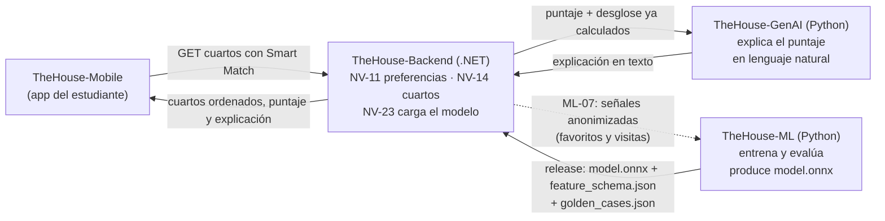
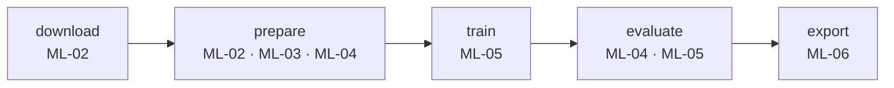
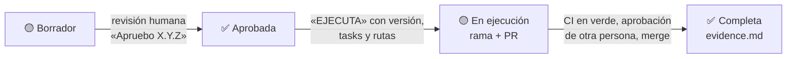
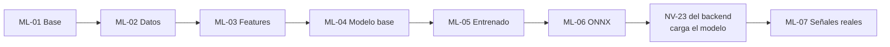

# TheHouse ML — Arquitectura del proyecto y de sus specs

| Campo | Valor |
| --- | --- |
| Documento | `specs/ARQUITECTURA.md` |
| Versión | 1.0.0 |
| Fecha | 2026-11-09 |
| Naturaleza | Guía de lectura. No es una spec y no autoriza código: cada spec se aprueba y ejecuta por separado |
| Autoridad | `constitution.md` → `AGENTS.md` → `memoria.md` → specs. Si este documento contradice una spec, manda la spec |

## 1. De qué trata el proyecto

TheHouse ayuda a estudiantes a encontrar cuarto cerca de su universidad. **Smart Match** es la función que, para un estudiante, ordena los cuartos de "más compatible" a "menos compatible" y le dice por qué.

`TheHouse-ML` es el proyecto de Machine Learning que construye ese cálculo:

- **Entrada:** el perfil de búsqueda del estudiante (presupuesto, distancia máxima, servicios que necesita, con quién quiere vivir, tipo de lugar, mascotas, transporte, universidad) y los datos públicos de un cuarto (renta, ubicación, servicios, tipo, reglas).
- **Salida:** un **puntaje de 0 a 100** con su **desglose por factor**, por ejemplo (ML-04 1.0.0): presupuesto 25.5/30, distancia 17.0/25, servicios 13.3/20, tipo de lugar 10.0/10, tipo de inmueble 10.0/10, extras 2.1/5 → **78** (el total redondea la suma sin redondear de los factores).
- **Entregable:** un archivo de modelo **ONNX** versionado, con su esquema de entrada, su ficha técnica y su reporte de evaluación. El backend lo carga y lo ejecuta; este proyecto **no es un servidor**.

Todo el proyecto se hace en **Python 3.12**, con herramientas gratuitas (pandas, scikit-learn, LightGBM, ONNX) y costo $0.

## 2. Los tres proyectos de TheHouse



| Proyecto | Responsable de | Nunca hace |
| --- | --- | --- |
| `TheHouse-ML` | Datos, features, entrenamiento, evaluación y el artefacto ONNX | Exponer una API, guardar datos de usuarios, llamar a un LLM |
| `TheHouse-Backend` | Guardar preferencias y cuartos, calcular features en producción, ejecutar el ONNX, orquestar | Entrenar modelos |
| `TheHouse-GenAI` | Redactar la explicación del puntaje y convertir búsquedas en texto a filtros | Calcular o modificar el puntaje (Artículo 2 de su constitución) |

El contrato entre ML y el backend es el **esquema de features** (`feature_schema.json`): si cambia, cambian las specs de los dos repositorios.

## 3. El pipeline

Un comando por etapa: `python -m thehouse_ml <etapa>`. Cada etapa lee la salida de la anterior.



| Etapa | Lee | Escribe | Spec |
| --- | --- | --- | --- |
| `download` | INEGI (Censo 2020 muestra, ENVI 2020, ENIGH 2022, DENUE, INPC), OpenStreetMap | `data/raw/` + manifiesto SHA-256 en `data/manifests/` | ML-02 |
| `prepare` | `data/raw/`, seed de TheHouse, tablas de mapeo | Bases nacionales, calibración regional, entorno de campus, catálogo sintético de cuartos (ML-03) y universidades (`data/processed/`); estudiantes sintéticos y pares estudiante–cuarto con las 10 features del esquema 2.0.0 (ML-03, ML-04); etiquetas sintéticas de relevancia `labels.parquet` y `reports/labels_synthetic.md` (ML-04) | ML-02, ML-03, ML-04 |
| `train` | Pares y etiquetas (`labels.parquet`) de train + validación, en 5 pliegues por estudiante (ML-05; nunca la utilidad ni los pesos ocultos) | Modelos entrenados en `models/` (sin pickle: JSON y texto nativo de LightGBM). El modelo base por reglas **no se entrena**: su configuración `baseline-1.0.0` está versionada en `src/thehouse_ml/models/baseline_params.json` | ML-05 |
| `evaluate` | Pares, etiquetas, estudiantes y cuartos; partición `test` | ML-04: `reports/baseline_report.md` y `reports/baseline_metrics.json` (métricas del modelo base, referencia de ML-05, **sintéticas**). ML-05 (medición única en test; la partición test se midió una vez en T03 y las corridas siguientes reproducen esa medición sin ajustar nada): `reports/trained_metrics.json` (métricas con IC, comparación pareada contra el modelo base, decisión de promoción y el bloque `breakdown` con calibración, distribución de `matchScore` y ejemplos explicados), `reports/trained_report.md`, `reports/ablation_metrics.json` y `reports/ablation_report.md` (4 métricas por pliegue, ablación y segmentos), `reports/trained_breakdown.md` (puntaje 0-100 y desglose) y `reports/model_card.md` (generada desde esos JSON; solo perfil `full`). Con `THEHOUSE_ML_TRAIN_PROFILE=ci` todo va a `models/ci/` (fuera de git, no oficial) | ML-04, ML-05 |
| `export` | Modelo promovido `logreg-1.0.0` (`models/logreg.json`, SHA-256 verificado; sin reentrenar), `feature_schema.json`, casos dorados y reportes de ML-05 | `dist/model-v1.0.0/` (fuera de git): `model.onnx` (grafo construido con `onnx`, double; salidas `factor_points` y `raw_total` sin redondear), `feature_schema.json`, `golden_cases.json` (logreg), `baseline_golden_cases.json` (respaldo en C#), `model_card.md`, `metrics.json` y `SHA256SUMS`. El Release `model-v1.0.0` lo publica el responsable a mano (ML-06 1.0.0, M-ML-044) | ML-06 |

Inside Airbnb fue **descartada por M-ML-019**: `download` no descarga ni verifica esa fuente y el catálogo de cuartos se generará **sintético en ML-03**, calibrado con INEGI y etiquetado como sintético.

`data/raw/`, `data/processed/` y `models/` **nunca** se suben a git (licencias y tamaño). Lo que sí se sube: código, manifiestos, tablas de mapeo, configuración y reportes.

## 4. Estructura del código

Cada carpeta la crea la spec indicada; ninguna existe antes de su «EJECUTA».

```text
TheHouse-ML/
├── pyproject.toml, uv.lock          ML-01  dependencias fijadas
├── .github/workflows/ci.yml         ML-01  ruff, mypy, pytest, pip-audit, gitleaks
├── src/thehouse_ml/
│   ├── __main__.py, cli.py          ML-01  python -m thehouse_ml <etapa>
│   ├── paths.py, config.py          ML-01  rutas y configuración
│   ├── data/                        ML-02  sources, download, manifest, national, regional, campus, rooms, universities, mappings/
│   ├── features/                    ML-03  schema, pairs, constraints (restricciones duras)
│   ├── synthetic/                   ML-03  generadores con semilla de estudiantes y del catálogo sintético de cuartos
│   ├── models/                      ML-04  baseline (reglas): baseline_params.json, baseline_config,
│   │                                       baseline_score, baseline_eval_params.json, baseline_report
│   │                                ML-05  training_data, train_config, train_params.json, train, train_report,
│   │                                       trained_eval, trained_report, factor_groups, ablation, ablation_report,
│   │                                       trained_breakdown, trained_breakdown_report, model_card
│   │                                (las etiquetas sintéticas de ML-04 van en synthetic/labels*)
│   ├── evaluation/                  ML-04/05  métricas de ranking por estudiante y bootstrap (ranking.py)
│   ├── export/                      ML-06  onnx_graph, parity, benchmark, package (casos dorados de logreg en tests/fixtures/)
│   └── signals/                     ML-07  ingesta de la exportación anonimizada
├── tests/                           todas  pruebas unitarias e integración (≥ 80 %)
├── data/raw, data/processed         ML-02  fuera de git
├── data/manifests/                  ML-02  en git
├── models/                          ML-04+ fuera de git (se publica como release)
├── dist/                            ML-06  paquete de entrega, fuera de git (lo publica el responsable)
├── docs/backend-integration.md      ML-06  guía de integración para NV-23
├── reports/                         ML-02+ data card, model card, métricas
├── notebooks/                       exploración, sin salidas guardadas
└── specs/                           este índice, la arquitectura y las specs
```

## 5. Cómo está hecha cada spec

Cada spec vive en `specs/ml-XX-nombre/` y tiene cuatro documentos, igual que en el backend:

| Documento | Para qué sirve | Qué lleva |
| --- | --- | --- |
| `spec.md` | **Qué** se va a construir y cómo se acepta | 1 Contexto · 2 Objetivo · 3 Precondiciones · 4 Alcance · 5 Fuera de alcance · 6 Diseño · 7 Reglas · 8 Seguridad, datos y privacidad · 9 Requisitos verificables (`ML-XX-R01`…) con criterio de aceptación · 10 Decisiones pendientes · 11 Costo · 12 Riesgos · 13 Dependencias · 14 Trazabilidad · 15 Aprobación |
| `plan.md` | **Cómo** y en qué orden | Enfoque y fases F1 Diseño y contrato → F2 Implementación → F3 Calidad, seguridad y datos → F4 Evidencia, con las tasks de cada fase |
| `task.md` | **Lista de trabajo** | Tasks `T01`… con requisito, aceptación y evidencia; matriz task → requisito y estado (ABIERTA / COMPLETA / BLOCKED) |
| `evidence.md` | **Prueba** de que se hizo | Se crea al ejecutar: commit, comandos, resultados, cobertura, hallazgos, revisión de coherencia y de licencias, y resultado PASS / PASS WITH WARNINGS / BLOCKED |

Ciclo de vida de una spec:



Las plantillas para specs nuevas están en [`_plantilla/`](_plantilla/); el paso a paso del flujo está en [`CONTRIBUTING.md`](../CONTRIBUTING.md).

Todo requisito tiene al menos una task y toda task tiene un requisito. El último requisito de cada spec siempre es "Pruebas y evidencia".

## 6. Qué lleva cada spec

| Spec | Tema | Qué se construye | Entregables principales | Tasks | Necesita antes |
| --- | --- | --- | --- | --- | --- |
| **ML-01** | Base del proyecto | Paquete Python con `uv`, comando con las 5 etapas vacías, calidad automática y CI | `pyproject.toml`, `uv.lock`, `cli.py`, `ci.yml`, prueba de que no se suben datos | 5 | Constitution 1.0.0 |
| **ML-02** | Datos | Bases **nacionales** de INEGI (renta, tenencia, servicios) ponderadas, **calibradas** a los 7 municipios de la región con respaldo estado → país, entorno de cada campus (DENUE), universidades verificadas y bases para el catálogo **sintético** de cuartos de ML-03 (Inside Airbnb descartada por M-ML-019) | `sources.toml`, manifiestos SHA-256, `national_baselines`, `regional_calibration`, `campus_context`, `universities.csv`, `reports/data_card.md` | 9 | ML-01; licencias de M-ML-003 aprobadas |
| **ML-03** | Esquema de features | Qué entra al modelo (estudiante, cuarto, par), restricciones duras (presupuesto, `livingWith`, mascotas), estudiantes sintéticos y catálogo **sintético** de cuartos (~3,000 cuartos entre los 10 campuses, calibrado con ML-02) | **✅ COMPLETA (M-ML-028):** `feature_schema.json` **1.1.0** validado contra NV-11 (`src/thehouse_ml/features/`, 7 features del par y restricciones duras HC01–HC03), casos dorados `tests/fixtures/pair_feature_cases.json` y `hard_constraint_cases.json`; `prepare` genera, **sintéticos y etiquetados**, `data/processed/students.parquet` (2,000), `rooms.parquet` (3,000) y `pairs.parquet` (candidatos que pasan las restricciones, hasta 200 por estudiante; partición 70/15/15 por estudiante sin fuga) con sus reportes en `reports/`. *Después:* ML-04 subió el esquema a **2.0.0** (versión mayor, M-ML-029/M-ML-030: 3 features nuevas al final, las 7 de ML-03 sin cambios) | 7 | ML-02; NV-11 del backend |
| **ML-04** | Modelo base por reglas | Puntaje determinista 0–100 (`baseline-1.0.0`) con pesos: presupuesto 30, distancia 25, servicios esenciales 20, tipo de lugar 10, tipo de inmueble (modalidad) 10, extras 5; esquema **2.0.0** (mayor) con `distance_ratio`, `price_below_min` y `extra_services_ratio`; etiquetas sintéticas de relevancia 0–3 | **✅ COMPLETA (M-ML-035):** `feature_schema.json` **2.0.0** (10 features); `src/thehouse_ml/models/baseline_params.json` **`baseline-1.0.0`** con su cargador y `score_features`/`score_pair` (`matchScore` y `breakdown`, pares excluidos sin puntaje); `prepare` genera **etiquetas sintéticas** `data/processed/labels.parquet` (`labels_params.json` 1.0.0, fuera de git); **81 casos dorados** `tests/fixtures/baseline_golden_cases.json` (recuento independiente; en ML-06 se empaquetan como `golden_cases.json`); `evaluate` escribe `reports/baseline_report.md` y `reports/baseline_metrics.json`, **métricas de referencia** sintéticas (test, 300 estudiantes: NDCG@10 0.527 [0.503, 0.550], NDCG@5, Precision@5 y MAP con bootstrap y segmentos, y métricas por estudiante); `src/thehouse_ml/evaluation/ranking.py` reutilizable por ML-05 | 7 | ML-03 |
| **ML-05** | Modelo entrenado | Reutiliza las etiquetas de ML-04 (`labels.parquet`, sin leer las ocultas); regresión logística (aditiva y explicable) y LightGBM LambdaRank con restricciones monotónicas (referencia del potencial); 5 pliegues por estudiante y estratificados por campus en train + validación, test una sola vez; se promueve solo si supera al baseline en NDCG@10 en los 5 pliegues, con intervalo pareado > 0 en test y desglose aditivo que suma el total | **✅ COMPLETA (M-ML-043):** `scikit-learn` 1.9.1 y `lightgbm` 4.7.0 en `uv.lock`; `train` (perfiles `full` y `ci`) con `models/logreg.json` (JSON, sin pickle) y `models/lightgbm_lambdarank.txt`; **`logreg-1.0.0` PROMOVIDO** (M-ML-041; `baseline-1.0.0` de respaldo): Δ NDCG@10 pareada en test +0.335 [+0.312, +0.360] y mayor que el baseline en 5/5 pliegues; recorte al `training_range` (nodo `Clip` en ML-06), calibración afín 0-100 y `breakdown` por los 6 factores con `maxPoints` variables y lista `features`; desviación aceptada T05-H1 (presupuesto no monótono con `budget.max/budget.min` > 76.2); ablación, segmentos e hipótesis > $3,500 confirmada; `reports/model_card.md` generada desde los JSON. Todo **sintético** | 7 | ML-04 |
| **ML-06** | Artefacto ONNX | Exportar `logreg-1.0.0` con un grafo construido con `onnx` (recorte al `training_range` → escalado → contribuciones → suma por factor → calibración afín, en double); el backend calcula features, reglas previas (faltantes, perfil incompleto, HC01–HC03), redondeo y JSON; paridad Python ↔ onnxruntime (≤ 1e-4 sin redondear, 0 en redondeados); casos dorados propios con recuento independiente; 200 cuartos en < 20 ms. LightGBM fuera de alcance; `baseline-1.0.0` de respaldo en C# (NV-23) con sus 81 casos dorados | **✅ 1.0.0 APROBADA (M-ML-044), sin ejecutar:** paquete de 7 archivos en `dist/model-v1.0.0/` (`model.onnx`, `feature_schema.json`, `golden_cases.json`, `baseline_golden_cases.json`, `model_card.md`, `metrics.json`, `SHA256SUMS`); Release `model-v1.0.0` publicado a mano por el responsable y verificado por SHA-256 en el build del backend; `docs/backend-integration.md` | 7 | ML-05 |
| **ML-07** | Señales reales | Evaluar y reentrenar con favoritos y visitas anonimizados de la app | Ingesta validada, métricas reales con partición temporal, nueva versión si mejora | 4 | Spec del backend que exporte señales; volumen mínimo |

Total: 7 specs, 46 tasks.

## 7. Qué significa cada resultado

- **Hasta ML-06** las etiquetas son sintéticas: el modelo aprende una utilidad documentada más ruido. Sus métricas demuestran que el pipeline funciona, **no** que el modelo acierte con estudiantes reales (constitution §8). Cada reporte lo dice así.
- **ML-07** es la primera vez que se puede afirmar desempeño real.
- El **modelo base por reglas** (ML-04) siempre existe: es la referencia contra la que se compara todo y el respaldo si un modelo entrenado no lo supera.

## 8. Orden de trabajo



ML-04 ya produce un puntaje útil: `baseline-1.0.0` es el respaldo y no se exporta a ONNX; NV-23 lo implementa en C# a partir de `baseline_params.json` y lo valida con sus 81 casos dorados, que ML-06 incluye en el paquete (`baseline_golden_cases.json`). El modelo que ML-06 exporta es `logreg-1.0.0`, promovido en ML-05 (M-ML-041).
