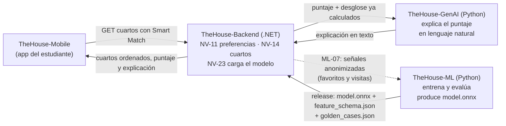
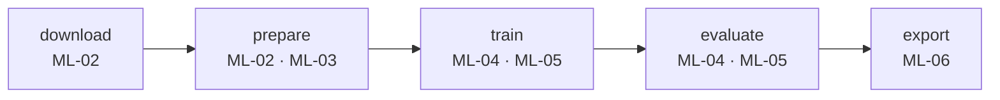
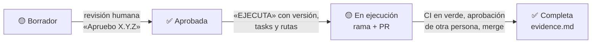
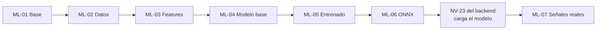

# TheHouse ML — Arquitectura del proyecto y de sus specs

| Campo | Valor |
| --- | --- |
| Documento | `specs/ARQUITECTURA.md` |
| Versión | 1.0.0 |
| Fecha | 2026-11-09 |
| Naturaleza | Guía de lectura. No es una spec y no autoriza código: cada spec se aprueba y ejecuta por separado |
| Autoridad | `constitution.md` → `AGENTS.md` → `memoria.md` → specs. Si este documento contradice una spec, manda la spec |

## 1. De qué trata el proyecto

TheHouse ayuda a estudiantes a encontrar cuarto cerca de su universidad. **Smart Match** es la función que, para un estudiante, ordena los cuartos de "más compatible" a "menos compatible" y le dice por qué.

`TheHouse-ML` es el proyecto de Machine Learning que construye ese cálculo:

- **Entrada:** el perfil de búsqueda del estudiante (presupuesto, distancia máxima, servicios que necesita, con quién quiere vivir, tipo de lugar, mascotas, transporte, universidad) y los datos públicos de un cuarto (renta, ubicación, servicios, tipo, reglas).
- **Salida:** un **puntaje de 0 a 100** con su **desglose por factor**, por ejemplo: presupuesto 28/30, distancia 20/25, servicios 15/20, tipo de lugar 10/10, modalidad 7/10, extras 3/5 → **83**.
- **Entregable:** un archivo de modelo **ONNX** versionado, con su esquema de entrada, su ficha técnica y su reporte de evaluación. El backend lo carga y lo ejecuta; este proyecto **no es un servidor**.

Todo el proyecto se hace en **Python 3.12**, con herramientas gratuitas (pandas, scikit-learn, LightGBM, ONNX) y costo $0.

## 2. Los tres proyectos de TheHouse



| Proyecto | Responsable de | Nunca hace |
| --- | --- | --- |
| `TheHouse-ML` | Datos, features, entrenamiento, evaluación y el artefacto ONNX | Exponer una API, guardar datos de usuarios, llamar a un LLM |
| `TheHouse-Backend` | Guardar preferencias y cuartos, calcular features en producción, ejecutar el ONNX, orquestar | Entrenar modelos |
| `TheHouse-GenAI` | Redactar la explicación del puntaje y convertir búsquedas en texto a filtros | Calcular o modificar el puntaje (Artículo 2 de su constitución) |

El contrato entre ML y el backend es el **esquema de features** (`feature_schema.json`): si cambia, cambian las specs de los dos repositorios.

## 3. El pipeline

Un comando por etapa: `python -m thehouse_ml <etapa>`. Cada etapa lee la salida de la anterior.



| Etapa | Lee | Escribe | Spec |
| --- | --- | --- | --- |
| `download` | INEGI (Censo 2020 muestra, ENVI 2020, ENIGH 2022, DENUE, INPC), Inside Airbnb, OpenStreetMap | `data/raw/` + manifiesto SHA-256 en `data/manifests/` | ML-02 |
| `prepare` | `data/raw/`, seed de TheHouse, tablas de mapeo | Bases nacionales, calibración regional, entorno de campus, catálogo de cuartos y universidades (`data/processed/`); estudiantes sintéticos y pares estudiante–cuarto | ML-02, ML-03 |
| `train` | Pares y etiquetas | Modelo base (reglas) y modelos entrenados en `models/` | ML-04, ML-05 |
| `evaluate` | Modelos y partición de prueba | `reports/metrics.json`, `reports/model_card.md`, comparación contra el modelo base | ML-04, ML-05 |
| `export` | Modelo promovido | `model.onnx`, `feature_schema.json`, `golden_cases.json`, `model_card.md`, `metrics.json`, `SHA256SUMS` | ML-06 |

`data/raw/`, `data/processed/` y `models/` **nunca** se suben a git (licencias y tamaño). Lo que sí se sube: código, manifiestos, tablas de mapeo, configuración y reportes.

## 4. Estructura del código

Cada carpeta la crea la spec indicada; ninguna existe antes de su «EJECUTA».

```text
TheHouse-ML/
├── pyproject.toml, uv.lock          ML-01  dependencias fijadas
├── .github/workflows/ci.yml         ML-01  ruff, mypy, pytest, pip-audit, gitleaks
├── src/thehouse_ml/
│   ├── __main__.py, cli.py          ML-01  python -m thehouse_ml <etapa>
│   ├── paths.py, config.py          ML-01  rutas y configuración
│   ├── data/                        ML-02  sources, download, manifest, national, regional, campus, rooms, universities, mappings/
│   ├── features/                    ML-03  schema, pairs, constraints (restricciones duras)
│   ├── synthetic/                   ML-03  generador de estudiantes con semilla
│   ├── models/                      ML-04  baseline (reglas)  ·  ML-05 labels, train
│   ├── evaluation/                  ML-04/05  métricas de ranking, reportes, segmentos
│   ├── export/                      ML-06  onnx, golden cases, paquete de entrega
│   └── signals/                     ML-07  ingesta de la exportación anonimizada
├── tests/                           todas  pruebas unitarias e integración (≥ 80 %)
├── data/raw, data/processed         ML-02  fuera de git
├── data/manifests/                  ML-02  en git
├── models/                          ML-04+ fuera de git (se publica como release)
├── reports/                         ML-02+ data card, model card, métricas
├── notebooks/                       exploración, sin salidas guardadas
└── specs/                           este índice, la arquitectura y las specs
```

## 5. Cómo está hecha cada spec

Cada spec vive en `specs/ml-XX-nombre/` y tiene cuatro documentos, igual que en el backend:

| Documento | Para qué sirve | Qué lleva |
| --- | --- | --- |
| `spec.md` | **Qué** se va a construir y cómo se acepta | 1 Contexto · 2 Objetivo · 3 Precondiciones · 4 Alcance · 5 Fuera de alcance · 6 Diseño · 7 Reglas · 8 Seguridad, datos y privacidad · 9 Requisitos verificables (`ML-XX-R01`…) con criterio de aceptación · 10 Decisiones pendientes · 11 Costo · 12 Riesgos · 13 Dependencias · 14 Trazabilidad · 15 Aprobación |
| `plan.md` | **Cómo** y en qué orden | Enfoque y fases F1 Diseño y contrato → F2 Implementación → F3 Calidad, seguridad y datos → F4 Evidencia, con las tasks de cada fase |
| `task.md` | **Lista de trabajo** | Tasks `T01`… con requisito, aceptación y evidencia; matriz task → requisito y estado (ABIERTA / COMPLETA / BLOCKED) |
| `evidence.md` | **Prueba** de que se hizo | Se crea al ejecutar: commit, comandos, resultados, cobertura, hallazgos, revisión de coherencia y de licencias, y resultado PASS / PASS WITH WARNINGS / BLOCKED |

Ciclo de vida de una spec:



Las plantillas para specs nuevas están en [`_plantilla/`](_plantilla/); el paso a paso del flujo está en [`CONTRIBUTING.md`](../CONTRIBUTING.md).

Todo requisito tiene al menos una task y toda task tiene un requisito. El último requisito de cada spec siempre es "Pruebas y evidencia".

## 6. Qué lleva cada spec

| Spec | Tema | Qué se construye | Entregables principales | Tasks | Necesita antes |
| --- | --- | --- | --- | --- | --- |
| **ML-01** | Base del proyecto | Paquete Python con `uv`, comando con las 5 etapas vacías, calidad automática y CI | `pyproject.toml`, `uv.lock`, `cli.py`, `ci.yml`, prueba de que no se suben datos | 5 | Constitution 1.0.0 |
| **ML-02** | Datos | Bases **nacionales** de INEGI (renta, tenencia, servicios) ponderadas, **calibradas** a los 7 municipios de la región con respaldo estado → país, entorno de cada campus (DENUE), catálogo de cuartos sin datos personales y universidades verificadas | `sources.toml`, manifiestos SHA-256, `national_baselines`, `regional_calibration`, `campus_context`, `rooms`, `universities.csv`, `reports/data_card.md` | 9 | ML-01; licencias de M-ML-003 aprobadas |
| **ML-03** | Esquema de features | Qué entra al modelo (estudiante, cuarto, par), restricciones duras (presupuesto, `livingWith`, mascotas) y estudiantes sintéticos | `feature_schema.json` validado contra NV-11, generador con semilla, pares sin fuga entre entrenamiento y prueba | 6 | ML-02; NV-11 del backend |
| **ML-04** | Modelo base por reglas | Puntaje determinista 0–100 con pesos: presupuesto 30, distancia 25, servicios 20, tipo de lugar 10, modalidad 10, extras 5 | Función de puntaje, pesos versionados, ≥ 50 casos dorados, reporte del modelo base | 5 | ML-03 |
| **ML-05** | Modelo entrenado | Regresión logística y LightGBM (LambdaRank) con validación cruzada por estudiante; se promueve solo si supera al modelo base | Métricas NDCG@10, Precision@5, MAP (media ± desviación), ablación, segmentos, `reports/model_card.md` | 6 | ML-04 |
| **ML-06** | Artefacto ONNX | Exportar el modelo promovido y comprobar que da lo mismo en Python y en ONNX; 200 cuartos en < 20 ms | Release `model-vX.Y.Z` con 6 archivos y hashes, `docs/backend-integration.md` | 6 | ML-05 |
| **ML-07** | Señales reales | Evaluar y reentrenar con favoritos y visitas anonimizados de la app | Ingesta validada, métricas reales con partición temporal, nueva versión si mejora | 4 | Spec del backend que exporte señales; volumen mínimo |

Total: 7 specs, 41 tasks.

## 7. Qué significa cada resultado

- **Hasta ML-06** las etiquetas son sintéticas: el modelo aprende una utilidad documentada más ruido. Sus métricas demuestran que el pipeline funciona, **no** que el modelo acierte con estudiantes reales (constitution §8). Cada reporte lo dice así.
- **ML-07** es la primera vez que se puede afirmar desempeño real.
- El **modelo base por reglas** (ML-04) siempre existe: es la referencia contra la que se compara todo y el respaldo si un modelo entrenado no lo supera.

## 8. Orden de trabajo



ML-04 ya produce un puntaje útil: si el tiempo del curso aprieta, el backend puede integrar el modelo base (ML-06 permite exportarlo como reglas documentadas) mientras ML-05 sigue en evaluación.
